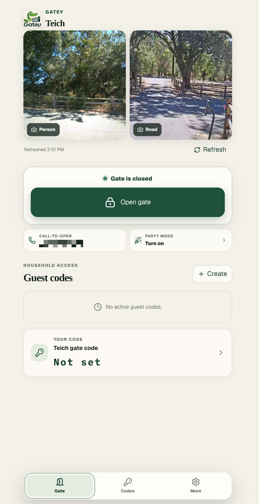
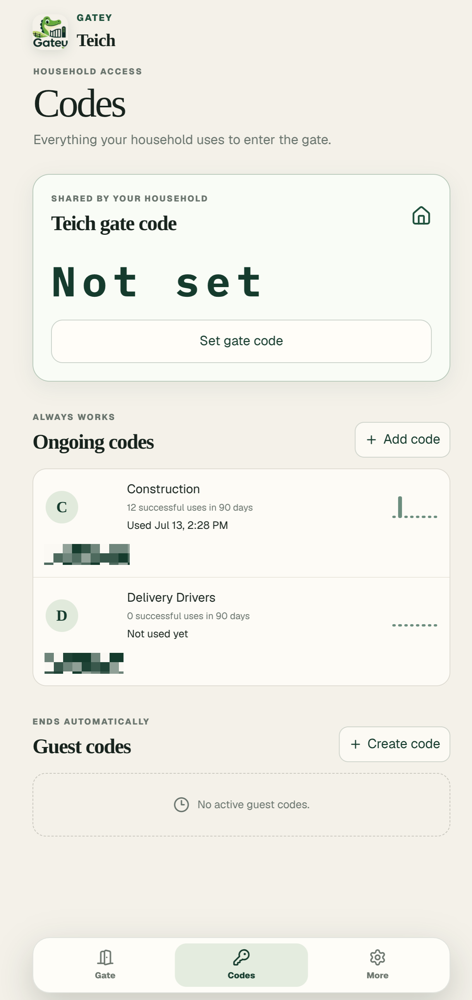
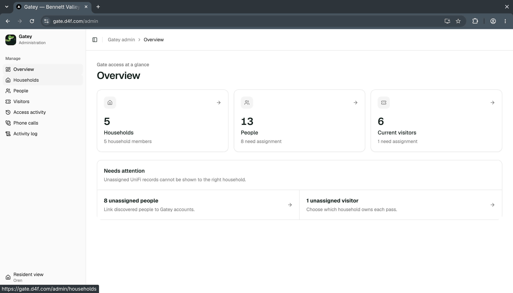
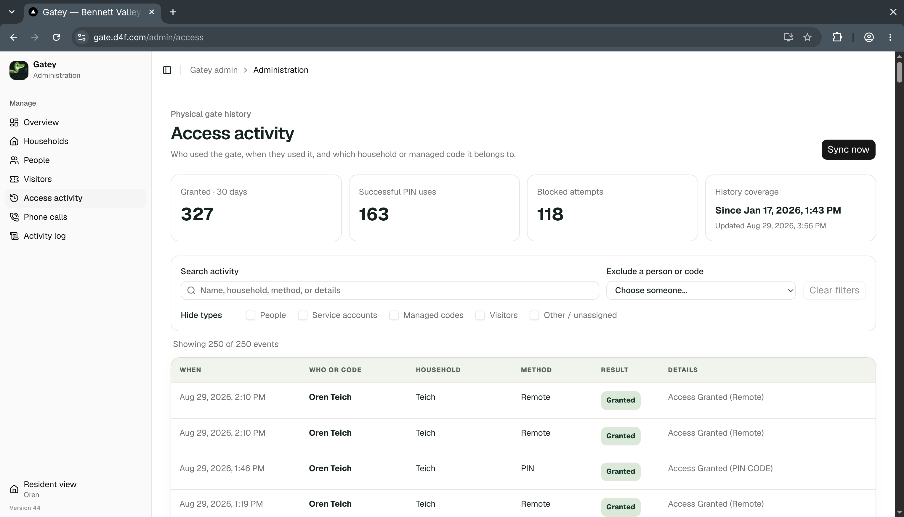

# Gatey

Gatey is a self-hosted web app for managing a shared residential gate through UniFi Access. Residents get a mobile interface for everyday access, while administrators manage households, people, visitors, and access history.

## Features

- View gate camera snapshots, check the gate state, and open the gate remotely.
- Create household, ongoing, and time-limited guest codes.
- Schedule party mode to hold the gate open for part of the day.
- Let authorized residents open the gate by phone with optional Twilio call-to-open.
- Connect Apple Shortcuts for an iPhone arrival-geofence pilot, without uploading location.
- Organize UniFi people and visitors by household, with searchable access activity and an administrative audit log.

## Resident experience

Residents can operate the gate and manage the codes that belong to their household from an installable mobile web app.

<p align="center">
  
  &nbsp;
  
</p>

## Administration

The administration interface connects UniFi records to households and provides a record of gate activity.





## Requirements

- Node.js 26 or later
- A UniFi Access controller
- `ffmpeg` for camera snapshots
- A Twilio number for call-to-open, if used

## Adding residents

In **Admin → Households**, use **Add person** beside the household, or use
**Admin → People → Add person**. Enter the person's first and last name, a
unique username, and optional email and call-to-open phone. Choose the UniFi
access policy used by residents and optionally enter a personal PIN. Gatey
creates the UniFi person, local account, and household membership, then assigns
the selected policy and PIN. Login details are shown for copying even without
an email; nothing is sent automatically.

The UniFi token needs `edit:user` and `view:policy`, in addition to the existing
inventory permissions. The server must have `GATEY_UNIFI_WRITES=true`. Policies
are selected explicitly; Gatey does not create new policies or assume that any
particular policy permits gate entry.

If credential setup fails, **Retry access setup** uses the person already
created. After closing the dialog, use **People → Gate access** to finish.
Saving Gate access replaces the person's policy assignments with the selected
policy; leaving its PIN field blank preserves their current PIN. If creation
itself times out, check People/UniFi before creating again: Gatey retains the
reserved account to prevent a duplicate request with the same username. An
unlinked UniFi person can be assigned to that existing account using **Assign**.

## Development

Install dependencies, copy `.env.example` to `.env`, and configure the required values for your environment. `GATEY_ADMIN_EMAIL` and `GATEY_ADMIN_USERNAME` name the first administrator. Then initialize the database and start the development server:

```bash
npm install
npm run db:migrate
npm run auth:create-admin
npm run dev
```

Run the project checks with:

```bash
npm test
npm run lint
npm run build
```

## Production deployment

Production runs on the home Proxmox server (WTR), not on a hosting platform:

- **Host:** LXC 107 `gatey` at `192.168.2.93`, DHCP-reserved. The app runs as `gatey.service` on port 3000, from `/opt/gatey`. Its environment is in `/etc/gatey/gatey.env` and its database in `/var/lib/gatey/gatey.sqlite`, with pre-deploy backups in `/var/lib/gatey/backups`.
- **Public access:** `https://gate.d4f.com` goes through a Cloudflare Tunnel. In the Teich Cloudflare account, the `d4f.com` zone routes `gate` to the remotely managed tunnel `HOMELAB_PROD`. That tunnel's connector runs in LXC 106 `cloudflared-teich` and forwards to `http://192.168.2.93:3000`. No ports are open on the router.
- **Configuration:** `BETTER_AUTH_URL` and `TWILIO_PUBLIC_BASE_URL` must be `https://gate.d4f.com`.

To deploy, push to `main` and run `npm run deploy:prod`. It builds locally with Node 26, uploads the standalone build over SSH, backs up the database, runs migrations, and rolls back if the health check fails. To copy the production database to your machine, run `npm run sync:prod-db`. The server inventory and the tunnel connector are documented in the onas repo (`ops/INVENTORY.md`).

### Single-process design

Gatey assumes it runs as exactly one Node.js process, as it does in production. The gate-status and door caches, the party-mode timer, and the deduplication of concurrent controller requests live in process memory, and SQLite is opened by that process alone. Running several instances behind a load balancer would need these moved into shared storage first.

The systemd timers call `/api/internal/*` over loopback. Those endpoints refuse requests that arrive through the Cloudflare Tunnel even when they carry the scheduler secret. Every other cookie-authenticated API change must carry Gatey's own `Origin` header (see `proxy.ts`).

## iPhone arrival automation

Open **More → Open on arrival** (or `/shortcuts`) on your iPhone:

1. Download **Open Gatey**, open it in Shortcuts, and choose **Add Shortcut**.
2. Choose **Create access key** in Gatey and copy the Authorization value.
3. Edit **Open Gatey**, expand the action’s options, and replace its Authorization
   header value with the copied value (including **Bearer** and the space).
4. Run it once at the gate to approve network access and confirm the gate opens.
5. Add an **Arrive** automation at the gate, choose **Run Immediately**, and run
   **Open Gatey**. Start with a boundary around 200 meters and adjust after a test drive.

The shortcut has exactly one **Get Contents of URL** action. Its URL
(`https://gate.d4f.com/api/shortcuts/open`), POST method, and Authorization header
name are already configured. Only the header value needs to be pasted. There is
no pairing exchange or iCloud connection file. Delete the old shortcut if installed.
Your phone needs internet connectivity at the arrival boundary; location stays
on the phone.

The key is displayed when created; if you lose it, create a replacement and
paste the new value into Shortcuts. Creating a replacement invalidates the old
key. **Disconnect shortcut access** disables it. The server still checks resident
access, logs openings, and suppresses duplicate requests for 30 seconds.

`BETTER_AUTH_URL` must be the public HTTPS origin. The existing shortcut database
migration must be applied with `npm run db:migrate`. The legacy pairing table is
retained for database compatibility but the pairing endpoint has been removed.

### Shortcut maintenance

The signed download and readable plist are checked in under `public/shortcuts`.
Regenerate on a Mac with Apple Shortcuts:

```bash
python3 scripts/build-shortcut.py
```

The default origin is `https://gate.d4f.com`; use `--base-url https://your-host`
when building for another deployment. Signing uses Apple’s `shortcuts sign
--mode anyone` and may require running outside a filesystem sandbox. Use
`--unsigned-only` to inspect the plist without signing.
